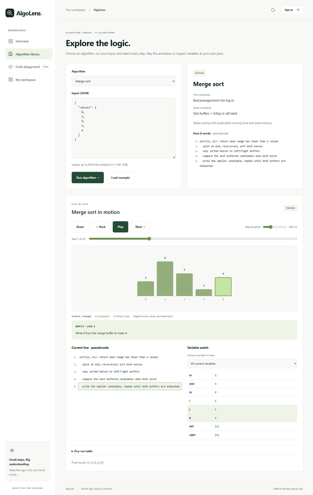
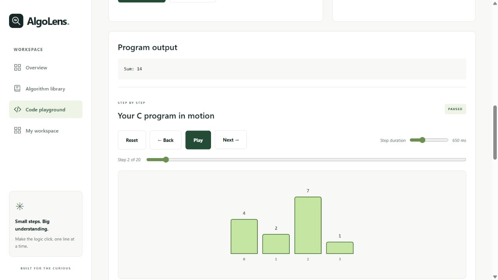
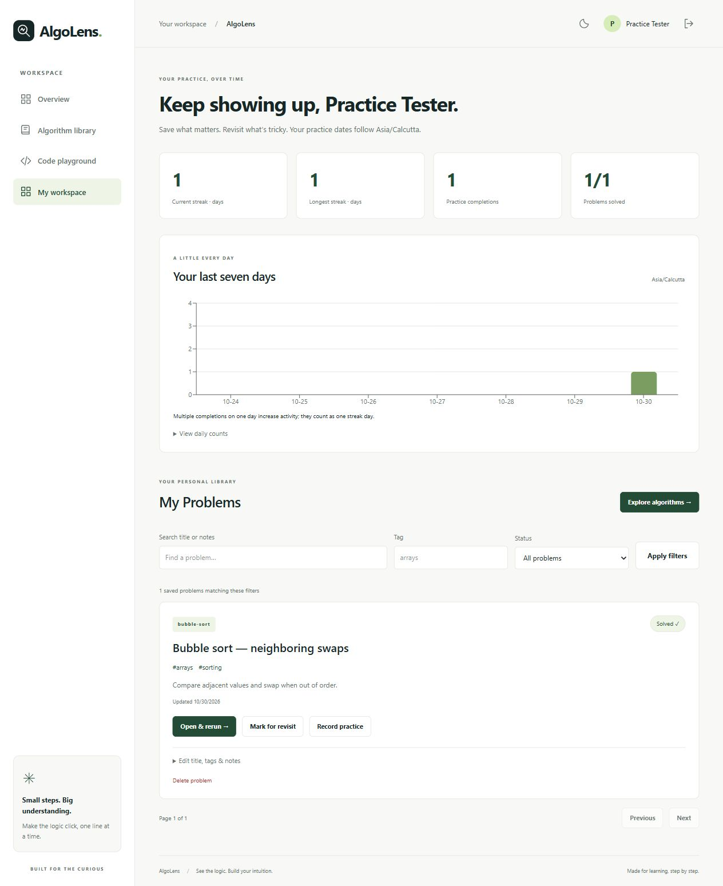

# AlgoLens

Learn algorithms by watching them execute, inspecting variables and replaying each step.

AlgoLens is a full-stack learning project built with React, Express and Prisma. It combines a library of 17 algorithms with a restricted JavaScript, Java and C teaching playground and a personal practice dashboard.

## Features

- Sorting: bubble, selection, insertion, merge and quick sort.
- Searching: linear and binary search.
- Graphs: BFS, DFS and Dijkstra.
- Dynamic programming: Fibonacci, 0/1 knapsack and longest common subsequence.
- Data structures: stack, queue, BST insertion and BST search.
- Array, graph, tree and grid views; play/pause, forward/back, speed and reset controls.
- Source-line highlighting, variable snapshots, dry-run tables and complexity notes.
- Upload or paste custom programs, select a variable to visualize and try randomized inputs.
- Register/login, saved problems, notes, tags, solved/revisit status, streaks and weekly activity.
- Responsive light/dark themes, keyboard controls and optional consent-based AI explanations.

Custom programs use a restricted interpreter in a Web Worker, not a native Java/C compiler or general JavaScript runtime. See [supported syntax and limits](docs/phase-6.md). Saved code is stored only when the user saves it; AI receives context only after explicit consent.

## Screenshots

These are captures from local development, not evidence of a hosted release.





## Stack and architecture

React 19, Vite 8, React Router, Tailwind CSS 4, Recharts, Context for authentication and React state/hooks for playback. Express 5, Prisma 6, JWT, bcrypt and Zod power the backend. SQLite runs locally; PostgreSQL is configured for hosting. Vitest, Supertest, ESLint, Prettier and GitHub Actions provide checks. Exact installed versions are pinned in the workspace manifests and lockfile.

```text
Browser: React routes + auth context
  |-- Library generators -> immutable steps -> playback -> visual + dry-run table
  |-- Custom editor -> restricted Worker interpreter -> same steps
  |-- Dashboard / save / optional AI
          |
          | /api (Vercel proxy in production; Express directly in development)
          v
Express: cookies + CSRF + validation + owner-scoped persistence
  |-- Prisma -> SQLite locally / Neon PostgreSQL when hosted
  +-- Optional AI provider (server key, explicit user consent)
```

Every step follows [one JSON schema](docs/step.schema.json). Playback changes the selected snapshot; stepping backward does not rerun the program. Algorithm complexity describes the underlying algorithm; recording and retaining visualization snapshots adds overhead.

## Run locally — PowerShell

Use Node.js 24.x (the project pins 24.21.0 in `.nvmrc`) and npm. Run these from the project root:

```powershell
Set-Location 'C:\coding\dsa project'
npm ci
npm run setup:env -w server
npm run db:generate -w server
npm run db:deploy -w server
```

The environment setup creates a local secret and preserves existing configuration. The default frontend configuration already targets `http://localhost:4000/api`; a client `.env` is optional. Keep secrets in `server/.env` and never in `VITE_` variables.

Start two terminals in the project root:

```powershell
# Terminal 1
npm run dev:server
```

```powershell
# Terminal 2
npm run dev:client
```

Open `http://localhost:5173`. The backend health endpoint is `http://localhost:4000/api/health`. There is no root `npm run dev` command; use the two commands above.

## Verify

```powershell
npm run db:check-schema
npm run lint
npm run format:check
npm test
npm run build
```

The Phase 9 baseline passed 149 tests: 101 client and 48 server tests. Tests cover generators, interpreter boundaries, worker lifecycle, authentication, saved-work ownership, practice tracking, mocked AI and the deployment proxy. Test counts describe automated coverage, not a security audit or performance benchmark.

For a manual demo: register, run bubble sort, step backward, inspect the dry-run table, open Custom Code and upload `docs/examples/Main.java`, trace a variable, then save and reopen work from the dashboard. AI remains usable as an optional feature only when configured; all core features work without a key.

## Repository map

```text
client/src/
  algorithms/       Library generators, registry and tests
  api/              Browser API client
  auth/             Authentication context and protected routes
  components/       Playback, visuals, tables and shared UI
  pages/            Overview, library, editor, auth and dashboard
  workers/          Restricted interpreter and Worker lifecycle
server/
  src/routes/       Auth, problems, practice and AI API routes
  src/middleware/   Trusted production proxy
  src/lib/          Authentication and errors
  src/services/     Practice aggregation and AI service
  prisma/           SQLite schema and migrations
  prisma-postgres/  PostgreSQL schema and migrations
  scripts/          Environment setup and isolated test runner
  test/             API integration tests
api/                Vercel same-origin proxy
scripts/            Schema sync and distributable packaging
docs/               Phase guides, examples, screenshots and portfolio material
.github/            CI and dependency update configuration
```

## API and data

See the [current API reference](docs/api.md). `User` owns `SavedProblem` and `PracticeLog` records. Problems are indexed by owner/update time and owner/status; practice events have an owner/event ID uniqueness constraint to make retries idempotent. Schemas are committed in both Prisma directories.

Passwords are hashed with bcrypt. JWTs use httpOnly cookies, and mutations require origin/CSRF protection. Queries scope private records to the authenticated owner. Production uses secure cookies and an authenticated same-origin proxy. Rate counters are currently in memory.

## Deployment and links

Source repository: [naveenkumarbuilds-stack/algolens](https://github.com/naveenkumarbuilds-stack/algolens).

- Local website: `http://localhost:5173`.
- Public website and backend: not deployed; no public URLs are claimed.
- Follow the [Vercel + Render + Neon guide](docs/phase-9.md) to publish.

Hosting configuration and PostgreSQL schema validation are ready. Actual PostgreSQL integration, hosting configuration and online smoke checks still need their first successful external run. SQLite data is not automatically transferred to PostgreSQL.

## Portfolio and next improvements

The [portfolio package](docs/portfolio.md) contains three resume bullets, ten interview questions with answers, a two-minute demo, a LinkedIn draft and ten stretch features. The [handover checklist](docs/phase-10.md) records final status and reproducible checks.

Future work includes full language execution in isolated infrastructure, shared rate limits, broader accessibility testing and collaboration. The restricted interpreter and free-tier deployment are deliberate learning-project tradeoffs.

## Downloadable source

Run `powershell -NoProfile -ExecutionPolicy Bypass -File scripts/package-project.ps1` to create `artifacts/AlgoLens-source.zip`. It includes source, tests, migrations, examples and docs, excluding credentials, databases, dependencies and build output. After extracting, follow the local setup above.

Phase guides describe the project's history; this README and the API reference describe the final implementation. Earlier design proposals and dependency-install snippets may differ from the final code. Use `npm ci` with the committed lockfile.
